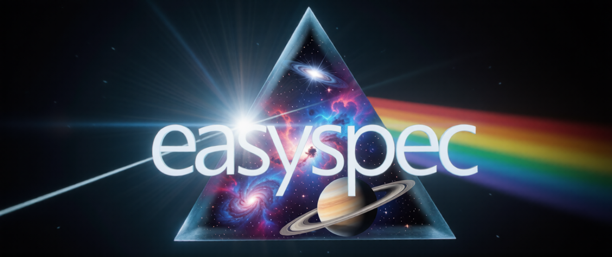
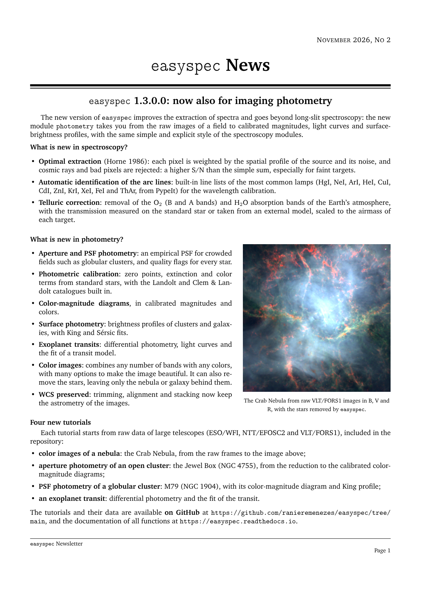

 

# easyspec

The easiest way to do long-slit spectroscopy and imaging photometry.

`easyspec` is a tool designed to streamline optical data analysis, offering an intuitive framework for:

* **Spectroscopy**: reducing raw long-slit data, extracting the spectra, calibrating them in wavelength and flux, and analyzing them
  (line fitting with MCMC, redshift, velocities, fluxes and more);
* **Photometry**: reducing raw images, aperture and PSF photometry, calibration with standard stars, color-magnitude diagrams,
  surface photometry, differential photometry of time series (e.g. exoplanet transits), and color images of any field.

  
   
  <em><code>easyspec</code> is developed at the Centro Brasileiro de Pesquisas Físicas (CBPF).</em>

If you'd like to support the maintenance of `easyspec` (or [easyfermi](https://github.com/ranieremenezes/easyfermi)), consider buying us a coffee:

### Current release 

 

# Requirements

- Linux OS / Mac OS / Windows

### Optional but recommended:
- [Miniconda 3](https://docs.conda.io/projects/miniconda/en/latest/),
  [Anaconda 3](https://conda.io/projects/conda/en/latest/user-guide/install/index.html) or [Miniforge](https://github.com/conda-forge/miniforge) (recommended) distribution.

# Installation

### Mamba-based installation 

The following instructions assume an installation of `conda` or `mamba` (i.e. a faster version of `conda`).

In the terminal, run (substitute *mamba* by *conda* if it is the case for you):
<pre><code>mamba create --name easyspec -c conda-forge python=3.11 scipy astropy emcee corner ccdproc matplotlib numpy photutils dust_extinction notebook tqdm</code></pre>

This will create the virtual environment and install all dependencies. Then activate the environment and install _easyspec_:
<pre><code>mamba activate easyspec
pip install easyspec</code></pre>

### Direct installation

If you don't have mamba or conda, you can install easyspec and its dependecies directly with pip:

<pre><code>pip install easyspec notebook</code></pre>

# Upgrading

You can check your currently installed version of `easyspec` with _pip show_:
<pre><code>pip show easyspec</code></pre>
   
If it is not the latest version, you can upgrade your installation by running the following command in the _easyspec_ environment:
<pre><code>pip install easyspec --upgrade --no-deps</code></pre>

# Uninstalling

In the terminal, run:
<pre><code>mamba deactivate</code></pre>
<pre><code>mamba env remove --name easyspec</code></pre>

# Tutorials and Documentation

The instructions on how to use `easyspec` can be found in the GitHub directory [tutorial](https://github.com/ranieremenezes/easyspec/tree/main/tutorial). The data used in the tutorials are in the directory [tutorial_data](https://github.com/ranieremenezes/easyspec/tree/main/tutorial_data), split into `spectroscopy` and `photometry`.

### Main spectroscopy tutorials

* [Image\_cleaning\_easyspec](https://github.com/ranieremenezes/easyspec/blob/main/tutorial/Image_cleaning_easyspec.ipynb): here we will guide you on how to reduce raw long-slit spectroscopic data, i.e., we will show you how to trim, debias, dedark, flatten, remove the cosmic rays, and stack the data.
* [spectroscopy\_tracing\_easyspec](https://github.com/ranieremenezes/easyspec/blob/main/tutorial/spectroscopy_tracing_easyspec.ipynb): here we will show you how to extract your spectra and calibrate them in wavelength and flux.
* [spectral\_analysis\_easyspec](https://github.com/ranieremenezes/easyspec/blob/main/tutorial/spectral_analysis_easyspec.ipynb): finally, we show you how to fit a model to each line of your spectrum with an MCMC approach and recover physical quantities such as redshift, dispersion velocity, FWHM, line flux and many more.

### Photometry tutorials

* [tutorial\_imaging](https://github.com/ranieremenezes/easyspec/blob/main/tutorial/tutorial_imaging.ipynb): from the raw VLT/FORS1 images of the Crab Nebula to a color image, made to taste with the many options of `generate_colored_image()`, and to a second color image where the stars were removed, leaving only the nebula.
* [tutorial\_photometry\_1\_open\_cluster\_NGC4755](https://github.com/ranieremenezes/easyspec/blob/main/tutorial/tutorial_photometry_1_open_cluster_NGC4755.ipynb): aperture photometry of the Jewel Box (NGC 4755) with the ESO/WFI: reduction of the images, color image of the cluster, photometric calibration with Landolt standard stars (zero points, extinction and color terms), calibrated color-magnitude diagrams, and how to calibrate with less data.
* [tutorial\_photometry\_2\_globular\_cluster](https://github.com/ranieremenezes/easyspec/blob/main/tutorial/tutorial_photometry_2_globular_cluster.ipynb): PSF photometry of the crowded globular cluster M79 (NGC 1904) with the NTT/EFOSC2: calibration with several standard fields and the built-in standard-star catalogues, color-magnitude diagram, and surface photometry with a King-profile fit.
* [tutorial\_photometry\_3\_exoplanet\_transit](https://github.com/ranieremenezes/easyspec/blob/main/tutorial/tutorial_photometry_3_exoplanet_transit.ipynb): differential photometry of a time series of images, the light curve of an exoplanet transit, and the fit of a transit model.
* [GMOS\_imaging\_cleaning\_tutorial](https://github.com/ranieremenezes/easyspec/blob/main/tutorial/GMOS_imaging_cleaning_tutorial.ipynb): cleaning of dithered Gemini/GMOS-N images, from the raw files (one extension per amplifier) to a single combined image in which the gaps between the CCDs are filled by the other exposures. The data are the "starfield" package of the [DRAGONS GMOS imaging tutorial](https://dragons.readthedocs.io/projects/gmosimg-drtutorial/en/stable/).

### Advanced spectroscopy tutorials

* [spectral\_analysis\_fitting\_a\_line\_with\_two\_Gaussians](https://github.com/ranieremenezes/easyspec/blob/main/tutorial/spectral_analysis_fitting_a_line_with_two_Gaussians.ipynb): here we fit the Hβ line with two Gaussian components and also explore the MCMC posterior distributions.
* [asymmetrical\_lines\_easyspec](https://github.com/ranieremenezes/easyspec/blob/main/tutorial/asymmetrical_lines_easyspec.ipynb): here we fit a skewed Lorentzian model to a C IV emission line, demonstrate how to construct a synthetic spectrum, and show how to manually define MCMC priors.
* [Stacking\_reduced\_spectra](https://github.com/ranieremenezes/easyspec/blob/main/tutorial/Stacking_reduced_spectra.ipynb): in this tutorial, we show you how to stack several spectra of the same target collected with different instruments.
* [Emission-in-Absorption](https://github.com/ranieremenezes/easyspec/blob/main/tutorial/Emission-in-Absorption.ipynb): here we show how to fit an emission-in-absorption Hβ line in a transition star-forming–AGN spectrum.
* [GMOS\_longslit\_dithers\_tutorial](https://github.com/ranieremenezes/easyspec/blob/main/tutorial/GMOS_longslit_dithers_tutorial.ipynb): reduction of Gemini/GMOS-S long-slit data with spectral and spatial dithers: conversion of the raw data, reduction of the target and of a standard star observed in another night, wavelength calibration with the CuAr lamp, flux and telluric calibrations, and stacking of all the exposures into a single spectrum. The data are the "dithered" package of the [DRAGONS GMOS long-slit tutorial](https://dragons.readthedocs.io/projects/gmosls-drtutorial/en/stable/ex1_gmosls_dithered.html).

The documentation of `easyspec` can be found in the header of all the functions, and at [this link](https://easyspec.readthedocs.io/en/latest/index.html).

### Overview about the software

An overview seminar on `easyspec`, presented in August 2025 at the University of São Paulo, is [available on YouTube](https://www.youtube.com/watch?v=o31VQCPTvWs).

# Acknowledgments

To acknowledge `easyspec` in a publication, please cite **de Menezes et al., 2025** (https://iopscience.iop.org/article/10.3847/1538-3881/adf220) and the DOI in [Zenodo](https://doi.org/10.5281/zenodo.15732788).

`easyspec` would not be possible without the many open-source packages, data and methods it is built on, and their authors deserve the
credit for their work. Depending on which parts of `easyspec` you use, please also cite the corresponding works below:

* **Always**: Astropy ([Astropy Collaboration 2013](https://doi.org/10.1051/0004-6361/201322068), [2018](https://doi.org/10.3847/1538-3881/aabc4f), [2022](https://doi.org/10.3847/1538-4357/ac7c74)), NumPy ([Harris et al. 2020](https://doi.org/10.1038/s41586-020-2649-2)), SciPy ([Virtanen et al. 2020](https://doi.org/10.1038/s41592-019-0686-2)) and Matplotlib ([Hunter 2007](https://doi.org/10.1109/MCSE.2007.55)).
* **Data reduction** (`cleaning`): ccdproc ([Craig et al.](https://doi.org/10.5281/zenodo.1069648)), and, for the removal of cosmic rays, astroscrappy ([McCully et al. 2018](https://doi.org/10.5281/zenodo.1482019)) and the L.A.Cosmic algorithm ([van Dokkum 2001](https://doi.org/10.1086/323894)).
* **Spectrum extraction and wavelength calibration** (`extraction`): the built-in line lists of the arc lamps (HgI, NeI, ArI, HeI, CuI, CdI, ZnI, KrI, XeI, FeI and ThAr) were taken from PypeIt ([Prochaska et al. 2020](https://doi.org/10.21105/joss.02308); BSD-3-Clause license, see `extraction/arc_lines/LICENSE_PypeIt.txt`), which compiled them from the [NIST Atomic Spectra Database](https://www.nist.gov/pml/atomic-spectra-database) and instrument calibrations: if you use them, please cite PypeIt and NIST.
* **Spectral analysis** (`analysis`): emcee ([Foreman-Mackey et al. 2013](https://doi.org/10.1086/670067)), corner ([Foreman-Mackey 2016](https://doi.org/10.21105/joss.00024)), for the extinction corrections dust_extinction ([Gordon 2024](https://doi.org/10.21105/joss.07023)), and, for the archival wavelengths used in the identification of the lines, the [NIST Atomic Spectra Database](https://www.nist.gov/pml/atomic-spectra-database).
* **Photometry** (`photometry`): Photutils ([Bradley et al.](https://doi.org/10.5281/zenodo.596036)), whose star detection follows DAOFIND ([Stetson 1987](https://doi.org/10.1086/131977)) and whose empirical PSF follows [Anderson & King (2000)](https://doi.org/10.1086/316632). Also, depending on the analysis:
    * standard stars: [Landolt (1992)](https://doi.org/10.1086/116242), [Landolt (2009)](https://doi.org/10.1088/0004-6256/137/5/4186), [Landolt (2013)](https://doi.org/10.1088/0004-6256/146/5/131), [Clem & Landolt (2013)](https://doi.org/10.1088/0004-6256/146/4/88) and [Clem & Landolt (2016)](https://doi.org/10.3847/0004-6256/152/4/91), for the catalogue you use;
    * surface photometry: [King (1962)](https://doi.org/10.1086/108756) for the King profile, [Sérsic (1963)](https://ui.adsabs.harvard.edu/abs/1963BAAA....6...41S) for the Sérsic profile, and [Jedrzejewski (1987)](https://doi.org/10.1093/mnras/226.4.747) for the isophote fits;
    * exoplanet transits: [Mandel & Agol (2002)](https://doi.org/10.1086/345520) for the transit model and [Kipping (2013)](https://doi.org/10.1093/mnras/stt1435) for the limb-darkening parametrization;
    * color images: [Lupton et al. (2004)](https://doi.org/10.1086/382245), if you use `color_mode="preserve"`.
* **Gemini GMOS data** (`gemini`): the detector tables (gains, read noise, saturation levels and geometry of the CCDs) and the line list of the GMOS CuAr arc lamp were taken from DRAGONS ([Labrie et al. 2023](https://doi.org/10.3847/2515-5172/ad0044); BSD-3-Clause license, see `gemini/gemini_gmos_lookup.py`): if you use them, please cite Labrie et al. (2023) and the [DRAGONS DOI in Zenodo](https://doi.org/10.5281/zenodo.10841622).

The fine-tuning of `easyspec` (code, tests, documentation and tutorials) was greatly helped by Claude, an AI assistant by Anthropic.

# News

