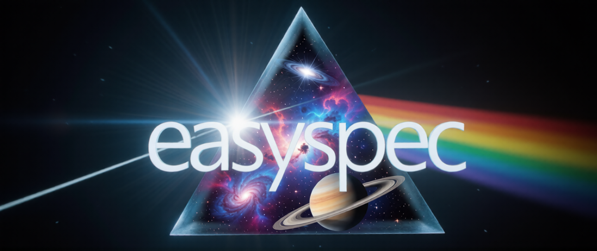

.. easyspec documentation master file, created by
   sphinx-quickstart on Mon Mar 24 13:20:42 2025.
   You can adapt this file completely to your liking, but it should at least
   contain the root `toctree` directive.

Welcome to easyspec's documentation!
====================================

Tutorials
---------

The instructions on how to use `easyspec <https://github.com/ranieremenezes/easyspec/tree/main>`_ can be found in the GitHub directory
`tutorial <https://github.com/ranieremenezes/easyspec/tree/main/tutorial>`_. The data used in the tutorials are in the directory
`tutorial_data <https://github.com/ranieremenezes/easyspec/tree/main/tutorial_data>`_, split into ``spectroscopy`` and ``photometry``.

Main spectroscopy tutorials
~~~~~~~~~~~~~~~~~~~~~~~~~~~

* `Image_cleaning_easyspec <https://github.com/ranieremenezes/easyspec/blob/main/tutorial/Image_cleaning_easyspec.ipynb>`_: here we will guide you on how to reduce raw long-slit spectroscopic data, i.e., we will show you how to trim, debias, dedark, flatten, remove the cosmic rays, and stack the data.
* `spectroscopy_tracing_easyspec <https://github.com/ranieremenezes/easyspec/blob/main/tutorial/spectroscopy_tracing_easyspec.ipynb>`_: here we will show you how to extract your spectra and calibrate them in wavelength and flux.
* `spectral_analysis_easyspec <https://github.com/ranieremenezes/easyspec/blob/main/tutorial/spectral_analysis_easyspec.ipynb>`_: finally, we show you how to fit a model to each line of your spectrum with an MCMC approach and recover physical quantities such as redshift, dispersion velocity, FWHM, line flux and many more.

Photometry tutorials
~~~~~~~~~~~~~~~~~~~~

* `tutorial_imaging <https://github.com/ranieremenezes/easyspec/blob/main/tutorial/tutorial_imaging.ipynb>`_: from the raw VLT/FORS1 images of the Crab Nebula to a color image, made to taste with the many options of ``generate_colored_image()``, and to a second color image where the stars were removed, leaving only the nebula.
* `tutorial_photometry_1_open_cluster_NGC4755 <https://github.com/ranieremenezes/easyspec/blob/main/tutorial/tutorial_photometry_1_open_cluster_NGC4755.ipynb>`_: aperture photometry of the Jewel Box (NGC 4755) with the ESO/WFI: reduction of the images, color image of the cluster, photometric calibration with Landolt standard stars (zero points, extinction and color terms), calibrated color-magnitude diagrams, and how to calibrate with less data.
* `tutorial_photometry_2_globular_cluster <https://github.com/ranieremenezes/easyspec/blob/main/tutorial/tutorial_photometry_2_globular_cluster.ipynb>`_: PSF photometry of the crowded globular cluster M79 (NGC 1904) with the NTT/EFOSC2: calibration with several standard fields and the built-in standard-star catalogues, color-magnitude diagram, and surface photometry with a King-profile fit.
* `tutorial_photometry_3_exoplanet_transit <https://github.com/ranieremenezes/easyspec/blob/main/tutorial/tutorial_photometry_3_exoplanet_transit.ipynb>`_: differential photometry of a time series of images, the light curve of an exoplanet transit, and the fit of a transit model.

Advanced spectroscopy tutorials
~~~~~~~~~~~~~~~~~~~~~~~~~~~~~~~

* `spectral_analysis_fitting_a_line_with_two_Gaussians <https://github.com/ranieremenezes/easyspec/blob/main/tutorial/spectral_analysis_fitting_a_line_with_two_Gaussians.ipynb>`_: here we fit the H :math:`{\beta}` line with two Gaussian components and also explore the MCMC posterior distributions.
* `asymmetrical_lines_easyspec <https://github.com/ranieremenezes/easyspec/blob/main/tutorial/asymmetrical_lines_easyspec.ipynb>`_: here we fit a skewed Lorentzian model to a C IV emission line, demonstrate how to construct a synthetic spectrum, and show how to manually define MCMC priors.
* `Stacking_reduced_spectra <https://github.com/ranieremenezes/easyspec/blob/main/tutorial/Stacking_reduced_spectra.ipynb>`_: in this tutorial, we show how to stack multiple spectra of the same target obtained with different instruments, spectral resolutions, and wavelength coverages.
* `Emission-in-Absorption <https://github.com/ranieremenezes/easyspec/blob/main/tutorial/Emission-in-Absorption.ipynb>`_: here we show how to fit an emission-in-absorption H :math:`{\beta}` line in a transition star-forming–AGN spectrum.

Contents
--------

.. toctree::
   :maxdepth: 2
   :caption: Contents:

   data_cleaning
   line_models
   modules
